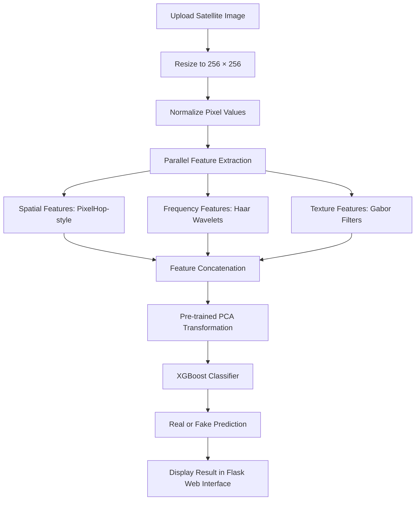

# Fake Satellite Image Detection Using Parallel Subspace Learning

An image-forensics system that classifies satellite imagery as **Real** or **Fake** by combining spatial, frequency, and texture features. The project uses a Parallel Subspace Learning (PSL)-inspired feature extraction pipeline and an XGBoost classifier, with a Flask web interface for image upload and prediction.

**Live application:** https://fake-satellite-detection-1.onrender.com

## Problem Statement

AI-generated satellite imagery can look convincing while containing subtle synthetic artifacts. Such imagery may undermine the reliability of applications that depend on satellite data, including urban planning, environmental monitoring, disaster management, and security.

This project explores a lightweight and interpretable approach to satellite image authenticity detection by analyzing complementary image characteristics instead of relying on a single feature representation.

## Proposed Solution

The system extracts three complementary feature groups from an input image:

- **Spatial features – PixelHop-style extraction:** Captures local structures and spatial patterns. The Flask inference implementation uses a custom PCA-based `CustomPixelHop` feature extractor.
- **Frequency features – Haar Wavelet Transform:** Decomposes image channels into multi-resolution sub-bands and computes statistical descriptors to identify frequency inconsistencies.
- **Texture features – Gabor Filters:** Analyzes texture responses at multiple orientations across RGB channels.

The extracted features are concatenated, transformed using a fitted PCA model, and passed to an XGBoost classifier to predict whether the image is real or fake.

## System Architecture



## Key Features

- **Satellite Image Upload:** Upload an image through a simple Flask-based web interface.
- **Multi-Subspace Feature Extraction:** Combines spatial, frequency, and texture descriptors for image analysis.
- **Dimensionality Reduction:** Applies a pre-fitted PCA model to transform the combined feature vector.
- **Binary Classification:** Uses a trained XGBoost model to classify an image as Real or Fake.
- **Prediction Interface:** Displays the uploaded image and its classification result in the browser.

## Dataset

The project uses the **DM-AER-DeepFake-V1** dataset:

- **Synthetic images:** 1,000,000 StyleGAN2-generated aerial images.
- **Real images:** 120,000 images sourced from the Million-AID dataset.
- **Image format and resolution:** JPEG, 256 × 256 pixels.

The dataset is not included in this repository. The repository contains the saved inference models required by the web application.

## Methodology

1. **Preprocessing:** Resize images to 256 × 256 and normalize pixel values to the range [0, 1].
2. **Spatial feature extraction:** Divide images into 16 × 16 patches and derive PCA-based PixelHop-style spatial descriptors.
3. **Frequency feature extraction:** Apply a two-level Haar wavelet decomposition and calculate statistical features from the resulting sub-bands.
4. **Texture feature extraction:** Apply Gabor filters at 0°, 60°, and 120° orientations across RGB channels.
5. **Feature fusion:** Concatenate the extracted spatial, frequency, and texture features.
6. **Classification:** Transform the fused feature vector using the saved PCA model and classify it using XGBoost.

## Experimental Results

The evaluated feature-based XGBoost models achieved the following accuracy:

| Feature set | Accuracy |
|---|---:|
| PixelHop spatial features | 64.20% |
| Haar Wavelet features | 82.60% |
| Gabor texture features | 66.60% |
| Combined features (PSL) | **92.38%** |

### Combined Model Performance

The final combined-feature model was evaluated on **800 images**:

- **Correctly classified real images:** 396
- **Correctly classified fake images:** 343
- **Total correctly classified:** 739 out of 800 images (**92.38%**)
- **Incorrectly classified:** 61 images
- **False positives:** 26
- **False negatives:** 35
- **ROC-AUC:** 0.98

The model correctly classified 739 images, while 61 images were misclassified in this evaluation.

## Technology Stack

- **Language:** Python
- **Web framework:** Flask
- **Machine learning:** XGBoost, Scikit-learn, PCA
- **Image processing:** OpenCV, NumPy
- **Feature extraction:** PyWavelets, scikit-image (Gabor filters)
- **Model persistence:** Pickle
- **Deployment:** Gunicorn

## Repository Structure

```text
fake-satellite-detection/
├── app.py              # Flask application and image prediction pipeline
├── templates/
│   └── index.html      # Image upload and prediction interface
├── xgb_model.pkl       # Pre-trained XGBoost classifier
├── pca_model.pkl       # Pre-fitted PCA transformer
├── requirements.txt    # Python dependencies
├── Procfile            # Gunicorn deployment command
└── README.md
```

## Getting Started

### Prerequisites

- Python 3.9 or later
- pip

### 1. Clone the repository

```bash
git clone https://github.com/Shanmugharini/fake-satellite-detection.git
cd fake-satellite-detection
```

### 2. Create and activate a virtual environment (recommended)

**Windows:**

```bash
python -m venv venv
venv\Scripts\activate
```

**macOS / Linux:**

```bash
python3 -m venv venv
source venv/bin/activate
```

### 3. Install dependencies

```bash
pip install -r requirements.txt
```

### 4. Run the application

```bash
python app.py
```

Open **http://localhost:5000** in your browser.

### 5. Make a prediction

1. Select a satellite image using the upload control.
2. Click **Check Image**.
3. View the uploaded image and the predicted label: **Real Satellite Image** or **Fake Satellite Image**.

## Important Notes

- The application loads `xgb_model.pkl` and `pca_model.pkl` from the repository root. Keep both files in that location when running the app.
- The training dataset and complete training notebooks/scripts are not included in this repository; the saved model artifacts are used for inference.
- Pickle model files should only be loaded from sources you trust.
